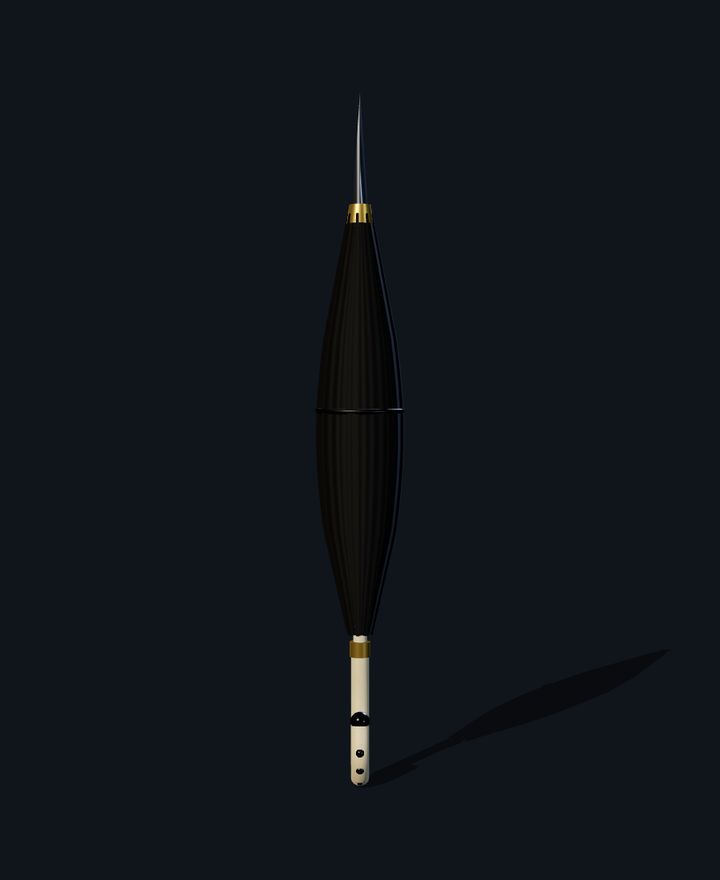
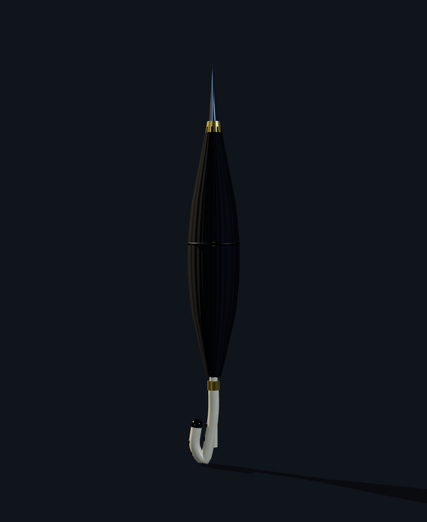
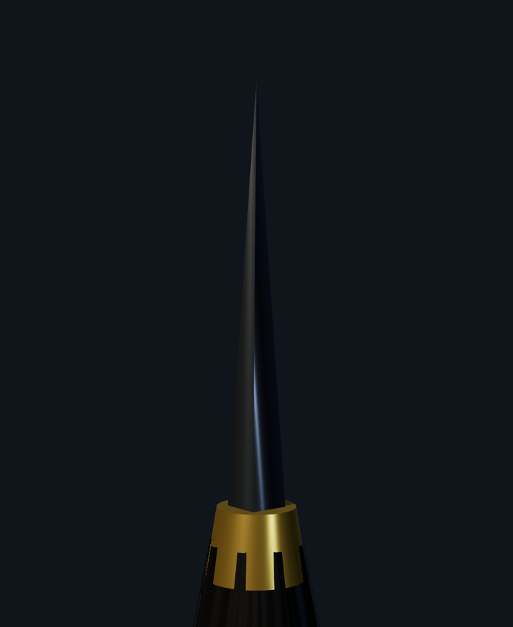

# Mistress Martha Crape — Mourner's Spiked Mortuary Brolly

The model is **`public/models/props/prop_crape_spiked_brolly.glb`** (`346,924` bytes, `6,184` triangles).

### Budgets and frame

| | measured | budget | |
|---|---|---|---|
| triangles | 6,184 | 25,000 | pass |
| file size | 346,924 B (0.331 MB) | 1.5 MB | pass |
| width | 11.9 cm | 12.0 cm | pass |
| height | 91.9 cm | 92.0 cm | pass |
| depth | 11.9 cm | 12.0 cm | pass |

- **Origin** `(0, 0, 0)` sits at the crook handle grip axis.
- **Forward** is `+Z` pointing toward the ferrule lance; **up** is `+Y` along the umbrella shaft; units are metres.
- **Bounding box** min `(-6.0, -11.9, -6.0)` cm, max `(6.0, 80.0, 6.0)` cm.
- 6 meshes, 5 materials, 4 embedded data textures.

### Verification Renders

#### Front (0°)

#### Profile (90°)

#### Mortuary Ferrule Spear Spike Close-up

