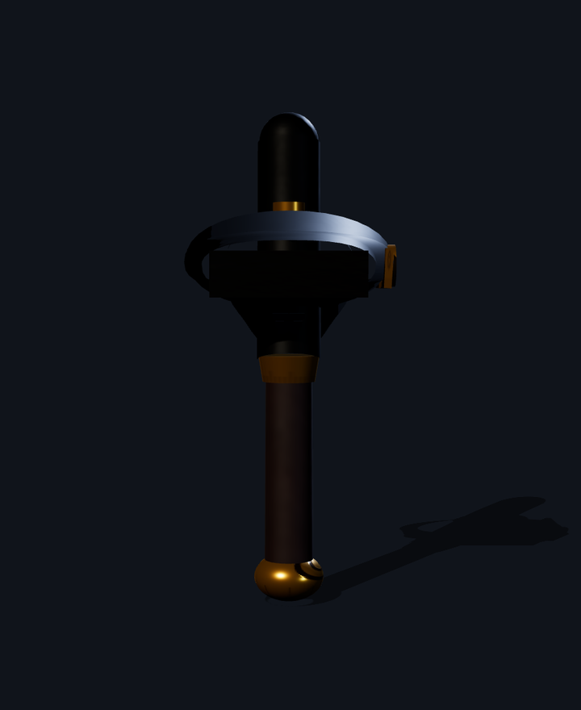
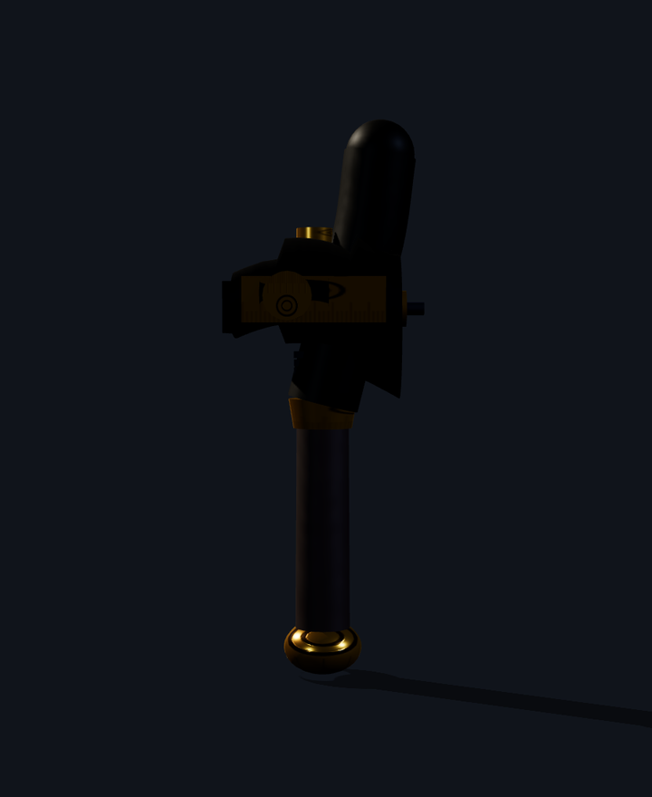
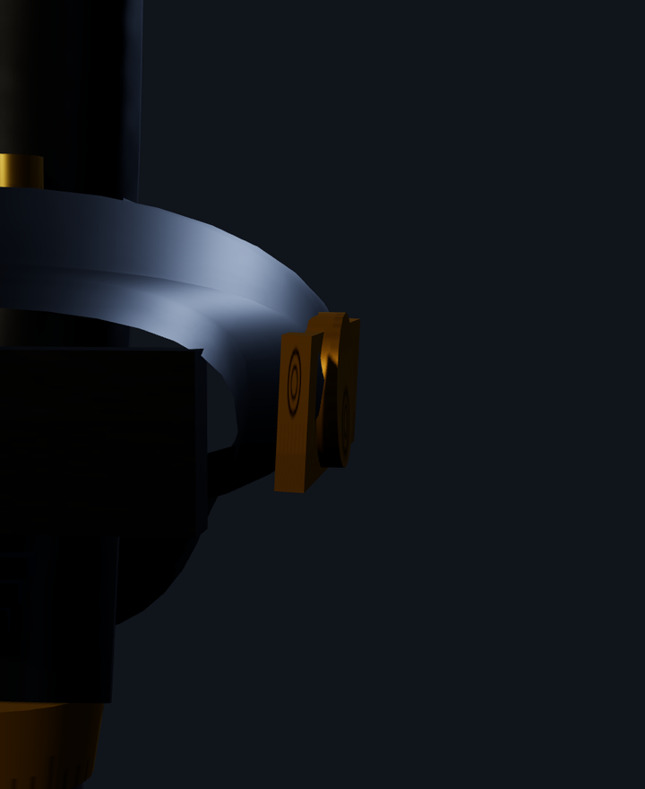

# Mistress Tabitha Pegg — Calibrated Cast-Iron Shoe Last

The model is **`public/models/props/prop_pegg_cast_iron_last.glb`** (`244,860` bytes, `4,316` triangles).

### Budgets and frame

| | measured | budget | |
|---|---|---|---|
| triangles | 4,316 | 30,000 | pass |
| file size | 244,860 B (0.234 MB) | 1.5 MB | pass |
| width | 14.0 cm | 14.0 cm | pass |
| height | 34.0 cm | 34.0 cm | pass |
| depth | 12.0 cm | 12.0 cm | pass |

- **Origin** `(0, 0, 0)` sits at the center of the leather handle grip.
- **Forward** is `+Z` pointing toward the chisel/anvil square toe; **up** is `+Y` along the heel horn finial; units are metres.
- **Bounding box** min `(-6.9, -14.9, -6.2)` cm, max `(7.1, 19.1, 5.8)` cm.
- 10 meshes, 4 materials, 6 embedded data textures.

### Verification Renders

#### Front (0°)

#### Profile (90°)

#### Brass Rule & Calibration Dial Close-up

